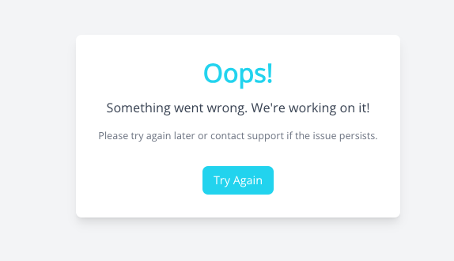
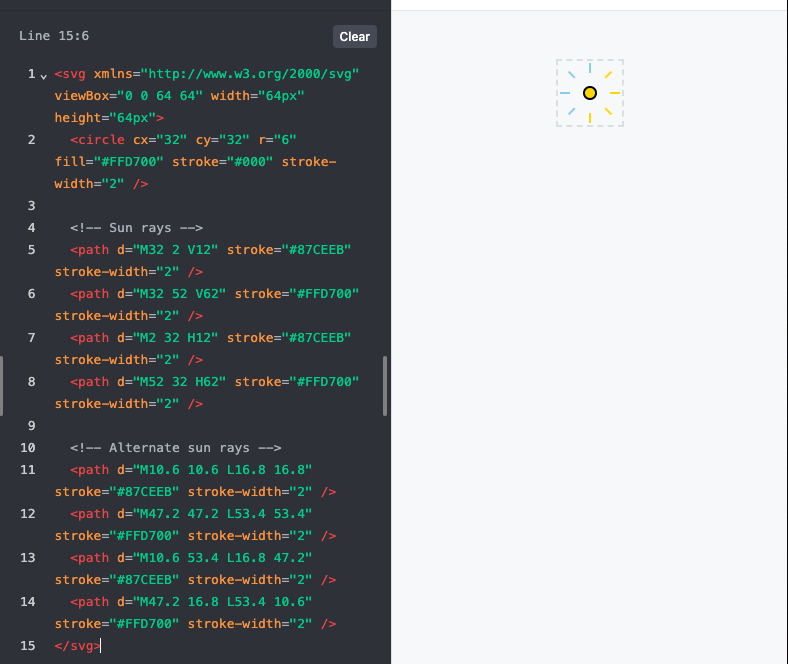
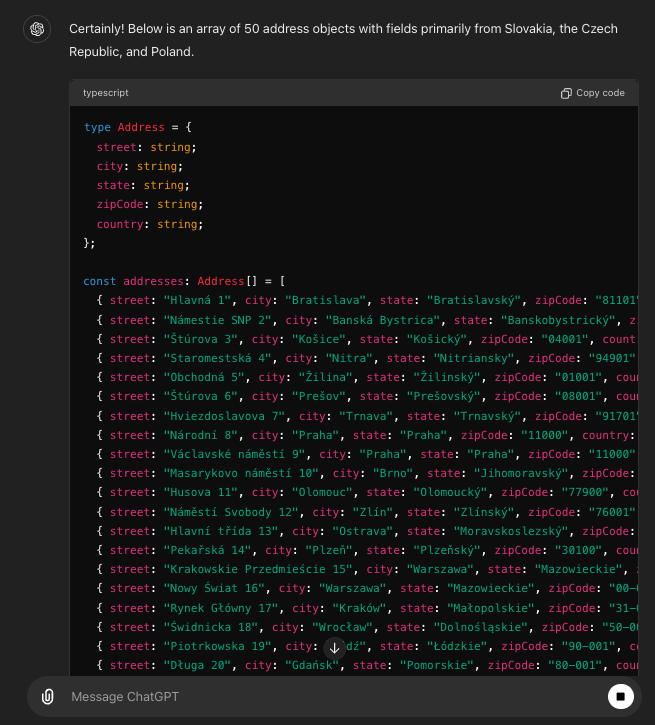
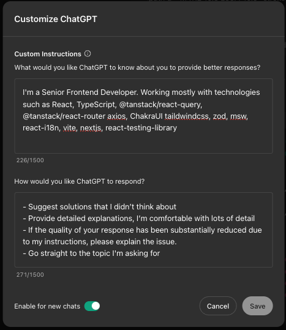

## Get an ultimate FE Assistant for Free

A while back, I was quite skeptical about trying out AI tools. I couldn't help but wonder if the subpar results I obtained were due to the AI model being in its beta phase, or if it was because I wasn't framing my questions well or providing enough context.

However, over the past few weeks and months, I've experienced a significant boost in my productivity with AI, particularly in my main field of front-end development, as well as in areas like copywriting, where I usually struggle without AI assistance. Through this journey, I've gained valuable experience in using AI effectively, hopefully, it can help you a little bit.

Using AI in daily front-end development can help automate simple daily tasks, which usually involve manual or repetitive work.

## Use Cases:

## Generate a “Something went wrong” page with TailwindCSS

One command specifying what we want inside, second command to adjust colors and spacings based on our needs.



## Svg updates or generation

Update the size, color, or other attributes in a long **`<svg/>`** file. The command should be simple but specific, like **`Change colors in the SVG - 4 rays should be #87CEEB and 4 should be #FFD700; re-generate it`**"

```jsx
<svg
  xmlns="http://www.w3.org/2000/svg"
  viewBox="0 0 64 64"
  width="64px"
  height="64px"
>
  <circle cx="32" cy="32" r="6" fill="#FFD700" stroke="#000" stroke-width="2" />
  <path d="M32 2 V12" stroke="#000" stroke-width="2" />
  <path d="M32 52 V62" stroke="#000" stroke-width="2" />
  <path d="M2 32 H12" stroke="#000" stroke-width="2" />
  <path d="M52 32 H62" stroke="#000" stroke-width="2" />
  <path d="M10.6 10.6 L16.8 16.8" stroke="#000" stroke-width="2" />
  <path d="M47.2 47.2 L53.4 53.4" stroke="#000" stroke-width="2" />
  <path d="M10.6 53.4 L16.8 47.2" stroke="#000" stroke-width="2" />
  <path d="M47.2 16.8 L53.4 10.6" stroke="#000" stroke-width="2" />
</svg>
```

TADAA 🎉:



## Generating mock data

Generate a mock dataset based on a TypeScript type, API schema (like zod), JSON, Swagger or whatever definition. No external tools, for free.

```
"I have this type:"
type Address = {
  street: string;
  city: string;
  state: string;
  zipCode: string;
  country: string;
};

Generate array of 50 addresses, use countries and all fields primarily from Slovakia, Czech republic and Poland
```



## Long pages - documentations, GitHub discussions etc

- Search for specific information in a long documentation page (especially if it doesn’t have a good search function).
- Get outcome from GitHub issue based on comments from the long thread.

This could save you a ton of time.

## Make a diff between two versions of a file.

Make a diff between some texts might be done of course by tools like [https://www.diffchecker.com/text-compare/](https://www.diffchecker.com/text-compare/).

Sometimes we need to compare data with context, such as two minified/compiled code files that are running on different versions of an API. We need to understand what has changed that caused the bug we are debugging.

## Code Improvement

- Ask for a ways to improve the readability of your code and rewrite it.
- Give a code from a PR of your team-mate as an input. Ask to find potential problems based on your project criterial - clean code, performance, security etc.

**Testing**

- Generate unit/integration tests to cover multiple scenarios
- Encourage AI to break your code with different testing scenarios or input data for your components, hooks, utilities

**Error Parsing**

- Parse long TypeScript errors, get important informations from it.

**Version Tracking**

- Search for a certain version of an npm package feature or bug that was introduced or fixed (we could pass change-log as input if needed)

**Bug Resolution**

- Use the AI’s suggestions, test them, and iterate based on the results. Sometimes AI can make a next step, sometimes not, but together you might be a great team 🙂

## Tips

- If your buddy gives you a solution with outdated or incorrect APIs, copy-paste the correct pages from the documentation to give it the correct context.
- **“Customize ChatGPT” section**

This is the nice place for guiding ChatGPT how it should generate custom type of responses for you, what do you prefer and what it should avoid to do. Give it enough context about you.



## Limitations

- Don’t expect a full working solution for a complex problem without providing much context.
- Be cautious when working with very new technologies or asking for examples.
- While AI tools are becoming increasingly advanced, it's crucial to verify the responses they provide as sometimes it’s misleading.
